# System Architecture & Technical Specifications

## High-Level Overview
**NetRAG** is a production-grade Hybrid Retrieval-Augmented Generation (Hybrid RAG) system engineered for specialized technical corpora. It combines lexical keyword matching (BM25 with network token preservation) with semantic vector search (Qdrant), fuses candidate rankings via **Reciprocal Rank Fusion (RRF)**, refines candidates through **Cross-Encoder Reranking**, and generates strictly grounded answers with verifiable provenance citations.

```mermaid
flowchart TD
    subgraph Ingestion Pipeline
        RawDocs[Raw Documents: MD, HTML, TXT, PDF] --> Loader[Document Loader]
        Loader --> Cleaner[Text Cleaner & Normalizer]
        Cleaner --> Chunker[Heading-Aware Chunker]
        Chunker --> Chunks[chunks.json with Stable IDs]
        Chunks --> BM25_Idx[(BM25 Okapi Index)]
        Chunks --> Qdrant_Idx[(Qdrant Vector DB)]
    end

    subgraph Query Execution
        UserQuery[User Technical Query] --> Sanitizer[Security Sanitizer]
        Sanitizer --> ParallelSearch{Dual Search}
        ParallelSearch --> BM25_Retriever[BM25 Retriever]
        ParallelSearch --> Dense_Retriever[Qdrant Dense Retriever]
        BM25_Retriever --> RRF[Reciprocal Rank Fusion k=60]
        Dense_Retriever --> RRF
        RRF --> Reranker[Cross-Encoder Reranker]
        Reranker --> CBuilder[Context Builder & Budget]
        CBuilder --> LLM[Grounded LLM Generator]
        LLM --> Validator[Citation & Abstention Validator]
        Validator --> FinalAnswer[Grounded Answer with Verified Citations]
    end
```

## Component Architecture

### 1. Ingestion & Document Processing (`app/ingestion/`)
- **Loaders (`loaders.py`)**: Multi-format loader supporting Markdown, plain text, HTML (via BeautifulSoup4), and PDF (via PyMuPDF).
- **Text Cleaner (`cleaner.py`)**: Strips pagination artifacts, form feeds, and redundant line endings while preserving Cisco IOS syntax, subnet masks, and code blocks.
- **Heading-Aware Chunker (`chunker.py`)**: Segment documents along markdown and structural headings. Preserves table and code block boundaries. Attaches deterministic IDs (`{doc_id}#chunk-{idx:03d}`) and provenance metadata (`source_url`, `topic`, `section`).

### 2. Dual-Channel Retrieval (`app/retrieval/`)
- **Keyword Stream (`bm25.py`)**: BM25 Okapi search engine with custom network tokenization preserving exact IP addresses (`192.168.1.0/24`), ports (`TCP/443`), flags (`SYN-ACK`), and RFC numbers.
- **Dense Vector Stream (`vector_search.py`, `embeddings.py`)**: Qdrant vector database using Cosine similarity over normalized 384-dimensional dense embeddings.

### 3. Fusion & Reranking
- **Reciprocal Rank Fusion (`fusion.py`)**:
  $$RRF(d) = \sum_{r \in R} \frac{w_r}{k + \text{rank}_r(d)}$$
  Smooths rank differences ($k=60$) without requiring raw score calibration between BM25 and vector spaces.
- **Cross-Encoder Reranker (`reranker.py`)**: Evaluates token proximity and section relevance between query and fused candidates.
- **Context Builder (`context_builder.py`)**: Deduplicates redundant passages and fits evidence into a configurable token budget.

### 4. Grounded Generation & Citation Verification (`app/generation/`)
- **Strict Grounding (`prompts.py`)**: Instructs model to rely exclusively on supplied evidence passages.
- **Automatic Abstention**: If the evidence is insufficient or question is out-of-scope, system automatically abstains:
  `"I do not have sufficient evidence in the networking corpus to answer this question."`
- **Citation Validator (`citations.py`)**: Parses citations (`[Doc: <doc_id>, Section: <sec>]`) and strictly validates them against retrieved chunks.

### 5. Security Controls (`app/security/`)
- **Indirect Prompt Injection Defense**: Redacts adversarial instructions inside documents (`Ignore previous instructions`, `System prompt override`).
- **Path Traversal Guard**: Restricts file loads strictly to authorized corpus directories.
